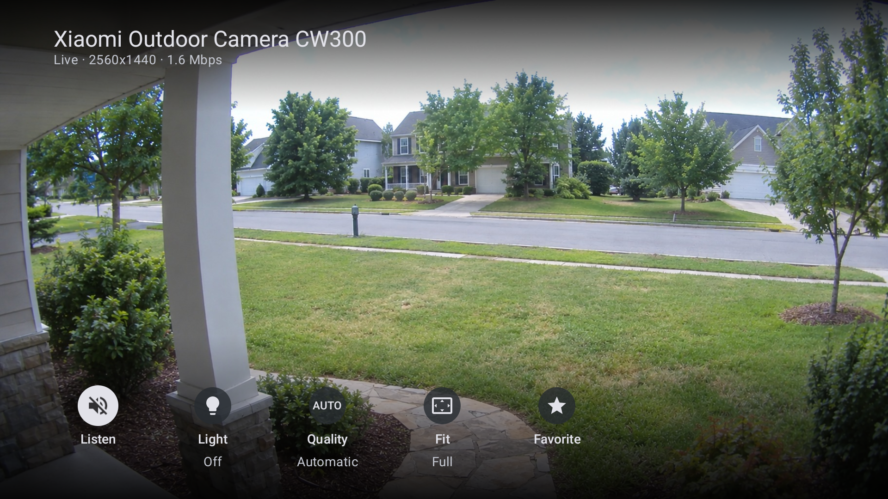
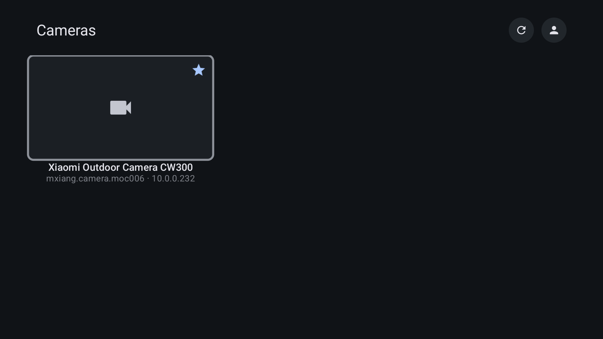
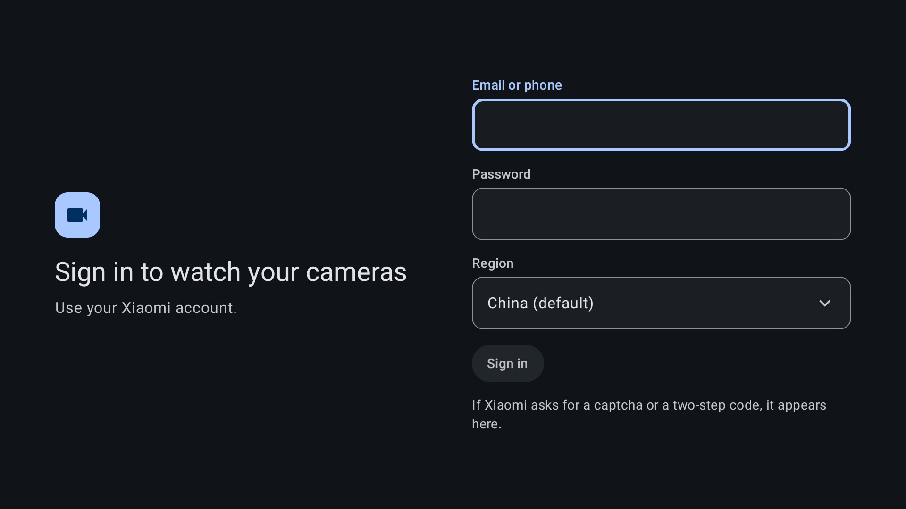

# Mxiang Camera Viewer for Android TV

A lightweight Android TV viewer for Xiaomi cameras, built with Jetpack Compose
for TV. Sign in with your Xiaomi account, pick a camera and watch it live on the
big screen, with sound, pan and tilt from the remote, and a few quick controls.

Video travels straight from the camera to the TV over the local network. Xiaomi's
cloud is only used to sign in, list your devices, exchange encryption keys and
read or write the fill light. The camera protocol lives in a Go library, the
bridge, which the app loads as an Android library.

| Live view                                                       | Cameras                                       | Sign in                                 |
|-----------------------------------------------------------------|-----------------------------------------------|-----------------------------------------|
|  |  |  |

The live picture in the first screenshot is an illustration: Android TV hides
video layers from screen captures.

## Features

- Sign in with a Xiaomi account, including captcha and two-step verification, for
  any cloud region
- Session token kept encrypted with a key that never leaves the Android Keystore
- Live view with hardware H.264 and H.265 decoding, sound, and pan and tilt with
  the arrow keys
- Quality (Automatic, Standard, High), fill light and picture fit (full screen,
  95% or 90%, for TVs that crop the edges)
- A favorite camera that opens by itself when the app starts
- Automatic reconnection, and the session closes while the app is in the
  background
- English and Spanish, following the system language

## Requirements

Android TV or Google TV with Android 11 (API 30) or newer, on the same local
network as the camera, and a Xiaomi account that owns it.

Cameras: tested on a CW300, on a Chromecast with Google TV (Android 14). The
bridge also supports the CW400, CW500 and CW700S, but they have not been tried on
Android. Dual-lens models such as the CW500 show up as two tiles.

## Using the app

| Where       | Key        | Action                                                   |
|-------------|------------|----------------------------------------------------------|
| Camera list | OK         | Open the camera                                          |
| Live view   | Arrow keys | Pan and tilt, while the controls are hidden              |
| Live view   | OK         | Show the controls: Listen, Light, Quality, Fit, Favorite |
| Live view   | Back       | Hide the controls, then return to the list               |

The controls hide by themselves after eight seconds. Typing on a TV is slow: the
Google TV phone app has a remote with a keyboard, and a USB or Bluetooth keyboard
works too.

## Building

You need Android Studio (with its JDK 21), [Go](https://go.dev/dl/) 1.26 or newer,
the Android NDK r27 (`27.2.12479018`), and `gomobile` (make sure `~/go/bin` is on
your path):

```
go install golang.org/x/mobile/cmd/gomobile@latest
go install golang.org/x/mobile/cmd/gobind@latest
```

The Go protocol code is in `bridge/`. Build it into an Android library, then the
app:

```
./gradlew buildBridge
./gradlew installDebug
```

`buildBridge` is only needed the first time and when `bridge/` changes. It
includes the 32-bit ARM build, which is not optional: many TV sticks, the
Chromecast with Google TV among them, run a 32-bit userland. To install on a real
TV, enable network debugging and `adb connect <tv-ip>` first.

Versions read `YEAR.RELEASE` (`26.1` is the first release of 2026). The single
source is `version.txt`, from which Gradle derives the `versionName` and a
growing `versionCode`. To release, edit it and run `./gradlew assembleRelease`,
which writes `MxiangCameraViewer_v<version>.apk`, for example
`MxiangCameraViewer_v26.1.apk`.

To add a language, copy `values/strings.xml` to `values-<code>/`, translate it,
and list it in `res/xml/locales_config.xml`.

## Credits

The bridge comes from
[xiaomi-camera-viewer](https://github.com/lubos-hnanicek/xiaomi-camera-viewer) by
Luboš Hnaníček and contributors (MIT), which in turn derives from
[go2rtc](https://github.com/AlexxIT/go2rtc) by Alexey Khit (MIT). See
`bridge/NOTICE.md`.

## License

[MIT](LICENSE). The code under `bridge/` keeps its own MIT license and notices, see `bridge/LICENSE`
and `bridge/NOTICE.md`.
